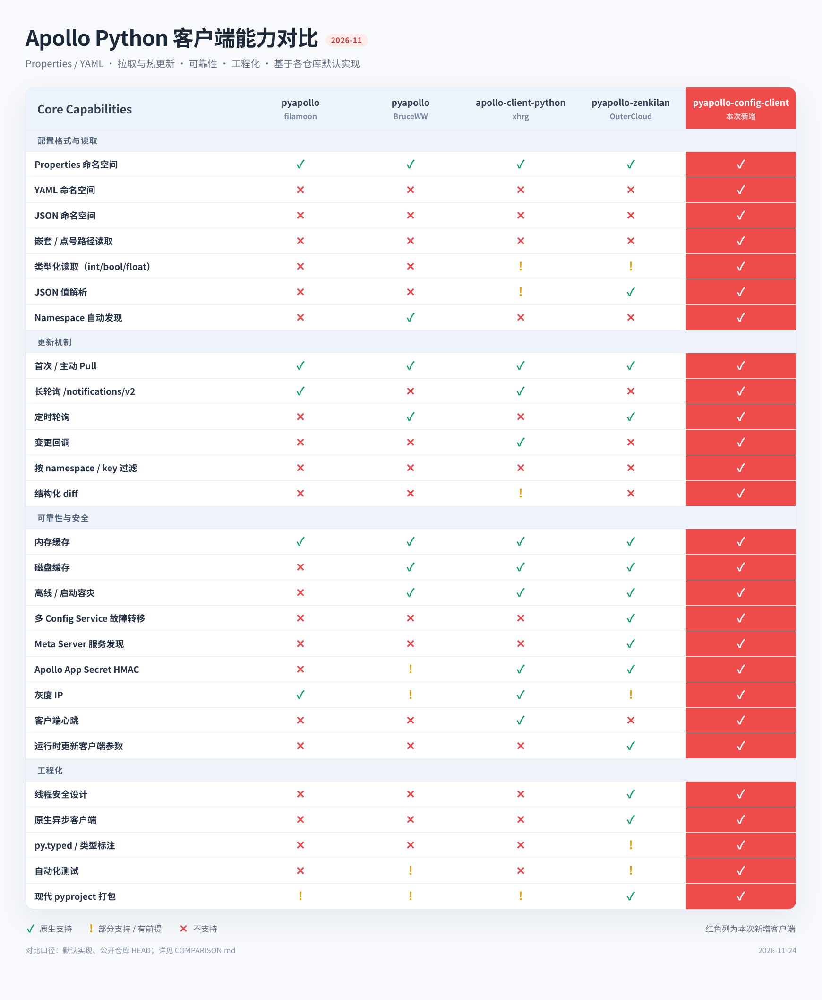

# Apollo Python 客户端能力对比

对比时间：2026-11-24 · 参考图 1 的分组能力矩阵形式 · 基于各仓库默认实现

本文对比 Apollo 生态中常见的四个 Python 客户端与本次新增的 `pyapollo-config-client`：

- [filamoon/pyapollo](https://github.com/filamoon/pyapollo)
- [BruceWW/pyapollo](https://github.com/BruceWW/pyapollo)
- [xhrg-product/apollo-client-python](https://github.com/xhrg-product/apollo-client-python)
- [OuterCloud/pyapollo](https://github.com/OuterCloud/pyapollo)
- **pyapollo-config-client（本次新增）**

> 只比较客户端能力，不评价 Apollo 服务端或部署方式。
>
> ✅ 原生支持 · ⚠️ 部分支持 / 有前提 · ❌ 不支持

## 客户端概览

| 客户端 | 安装名 | 版本 | 最近 push⁸ | License |
| --- | --- | --- | --- | --- |
| [filamoon/pyapollo](https://github.com/filamoon/pyapollo) | `pyapollo` | 0.0.1.dev1 | 2020-03 | Apache-2.0 |
| [BruceWW/pyapollo](https://github.com/BruceWW/pyapollo) | `apollo-client` | 2.1.2 | 2020-10 | Apache-2.0 |
| [xhrg-product/apollo-client-python](https://github.com/xhrg-product/apollo-client-python) | `apollo-client-python` | 1.0.1 | 2025-06 | MIT⁷ |
| [OuterCloud/pyapollo](https://github.com/OuterCloud/pyapollo) | `pyapollo-zenkilan` | 0.2.0 | 2025-12 | MIT |
| **pyapollo-config-client（本次）** | `pyapollo-config-client` | 0.2.0 | 2026-11 | Apache-2.0 |

## 配置格式与读取

| 能力 | filamoon | BruceWW | xhrg | OuterCloud | **pyapollo-config-client** |
| --- | :---: | :---: | :---: | :---: | :---: |
| Properties 命名空间 | ✅ | ✅ | ✅ | ✅ | ✅ |
| YAML 命名空间 | ❌ | ❌ | ❌ | ❌ | **✅** |
| JSON 命名空间 | ❌ | ❌ | ❌ | ❌ | **✅** |
| 嵌套 / 点号路径读取 | ❌ | ❌ | ❌ | ❌ | **✅** |
| 类型化读取（int/bool/float） | ❌ | ❌ | ⚠️¹ | ⚠️² | **✅** |
| JSON 值解析 | ❌ | ❌ | ⚠️¹ | ✅ | **✅** |
| Namespace 自动发现 | ❌ | ✅⁶ | ❌ | ❌ | **✅¹¹** |

## 更新机制

| 能力 | filamoon | BruceWW | xhrg | OuterCloud | **pyapollo-config-client** |
| --- | :---: | :---: | :---: | :---: | :---: |
| 首次 / 主动 Pull | ✅ | ✅ | ✅ | ✅ | ✅ |
| 长轮询 `/notifications/v2` | ✅ | ❌ | ✅ | ❌ | **✅** |
| 定时轮询 | ❌ | ✅ | ❌ | ✅ | **✅¹²** |
| 变更回调 | ❌ | ❌ | ✅³ | ❌ | **✅** |
| 按 namespace / key 过滤 | ❌ | ❌ | ❌ | ❌ | **✅** |
| 结构化 diff | ❌ | ❌ | ⚠️³ | ❌ | **✅** |

默认刷新行为：

| 客户端 | 刷新机制 | 默认刷新周期 / 超时 |
| --- | --- | --- |
| filamoon | 长轮询 | 请求超时 35s |
| BruceWW | 定时全量刷新 | 300s |
| xhrg | 长轮询 + 循环 | 长轮询 75s，循环间隔 2s |
| OuterCloud | 定时全量刷新 | 30s |
| **pyapollo-config-client** | 长轮询（默认）/ 定时轮询 | 长轮询 60s；轮询 60s；心跳 600s；Meta 刷新 300s |

## 可靠性与安全

| 能力 | filamoon | BruceWW | xhrg | OuterCloud | **pyapollo-config-client** |
| --- | :---: | :---: | :---: | :---: | :---: |
| 内存缓存 | ✅ | ✅ | ✅ | ✅ | ✅ |
| 磁盘缓存 | ❌ | ✅ | ✅ | ✅ | ✅ |
| 离线 / 启动容灾 | ❌ | ✅ | ✅ | ✅ | ✅ |
| 多 Config Service 故障转移 | ❌ | ❌ | ❌ | ✅ | **✅** |
| Meta Server 服务发现 | ❌ | ❌ | ❌ | ✅ | **✅¹³** |
| Apollo App Secret HMAC | ❌ | ⚠️⁴ | ✅ | ✅ | ✅ |
| 灰度 IP | ✅ | ⚠️⁵ | ✅ | ⚠️⁵ | ✅ |
| 客户端心跳 | ❌ | ❌ | ✅ | ❌ | **✅¹⁴** |
| 运行时更新客户端参数 | ❌ | ❌ | ❌ | ✅ | **✅** |

## 工程化

| 能力 | filamoon | BruceWW | xhrg | OuterCloud | **pyapollo-config-client** |
| --- | :---: | :---: | :---: | :---: | :---: |
| 线程安全设计 | ❌ | ❌ | ❌ | ✅ | **✅** |
| 原生异步客户端 | ❌ | ❌ | ❌ | ✅ | **✅¹⁰** |
| `py.typed` / 类型标注 | ❌ | ❌ | ❌ | ⚠️ | **✅** |
| 自动化测试 | ❌ | ⚠️ | ❌ | ⚠️ | **✅ 68 个** |
| 现代 pyproject 打包⁹ | ⚠️ | ⚠️ | ⚠️ | ✅ | **✅** |
| Python 支持 | 2.7 / 3.6 | 3.5+；3.13 不可用 | 2.x / 3.x | >=3.7；3.13 已测 | **>=3.10；3.10 / 3.13 已测** |

## 备注

¹ xhrg 通过 `eval` / `json.loads` 做类型转换，功能上支持，但存在安全风险；`get_value` 直接返回转换后的值。

² OuterCloud 只提供 `get_json_value`，没有 int / bool / float 等完整类型化 API。

³ xhrg 的回调形如 `(action, namespace, key, value)`，能表达 add / update / delete，但没有统一的事件对象或快照 diff。

⁴ BruceWW 支持传入静态 `Authorization` 请求头，但不是 Apollo App Secret 的 HMAC-SHA1 签名。

⁵ BruceWW 和 OuterCloud 都保存了 `ip` 参数，但当前代码在 `/configs` 请求中未携带 `ip`，灰度发布不会生效。

⁶ BruceWW 通过旧版 `/apps/{app}/clusters/{cluster}/namespaces` 接口自动发现 namespace；现代 Apollo 版本该接口可能返回 404。

⁷ xhrg 的 `setup.py` 声明 MIT，但仓库中没有 LICENSE 文件；如需商用请自行确认授权。

⁸ 最近 push 时间取自 GitHub API（2026-11-24 查询），版本号取自各仓库的 `setup.py` / `pyproject.toml`。

⁹ “现代打包”指包含 `pyproject.toml` 且可构建 wheel / sdist；仅有 `setup.py` 的记为部分支持。

¹⁰ `pyapollo-config-client` 提供原生 asyncio 客户端 `AsyncApolloClient`，位于可选依赖组 `[async]`（httpx）；核心包仍只依赖 `requests` 与 `PyYAML`。同步客户端仍是默认入口。

¹¹ `pyapollo-config-client` 的 Namespace 自动发现同样使用旧版 `/apps/{app}/clusters/{cluster}/namespaces` 接口；该接口不可用时自动降级为显式 namespace 列表，不阻塞启动。

¹² `pyapollo-config-client` 通过 `watch_mode="long_poll"`（默认）或 `"poll"` 选择刷新机制；定时轮询间隔由 `poll_interval` 控制，运行中可切换。

¹³ Meta Server 解析 `GET {meta}/services/config`，兼容字符串列表、`{"configServers": [...]}` 与 `{"homepageUrl": ...}` 三种响应；解析失败时保留当前 Config Service 地址。

¹⁴ 心跳是默认 600s 的定期全量补偿拉取（与 xhrg 一致），用于修复重启 / 网络抖动期间漏掉的通知；可通过 `heartbeat_interval` 调整或关闭，并通过 `status()` 暴露 `lastHeartbeatAt` / `heartbeatOk`。

## 选型建议

| 场景 | 建议 |
| --- | --- |
| 只需要最简 properties 拉取，且能接受长期不维护 | filamoon 实现最短，但缺少容灾与回调，不建议新项目直接采用 |
| 需要 properties、namespace 自动发现、文件缓存，能接受 300s 延迟 | BruceWW，但注意 Python 3.13 的 `telnetlib` 问题 |
| 需要 properties、长轮询、secret、回调、心跳 | xhrg，但注意无 LICENSE 文件、无过滤/事件对象 |
| 需要 Meta Server 发现、多节点、JSON 值解析 | OuterCloud |
| 需要 YAML / Properties、双模热更新、服务发现、心跳、结构化 diff、同步 + 异步 | **pyapollo-config-client** |

### 本次客户端的取舍

`pyapollo-config-client` 0.2.0 已覆盖此前矩阵中所有标记为“不支持”的能力：

- YAML / JSON namespace 与 Properties 原生字符串语义；
- 长轮询与定时轮询两种刷新机制，监听器可按 namespace、key 过滤，事件包含 added / updated / removed；
- Namespace 自动发现、Meta Server 服务发现及定期刷新；
- 心跳补偿拉取、磁盘缓存、secret 签名、多 Config Service 故障转移；
- 运行时更新客户端参数（地址、密钥、超时、灰度 IP、刷新模式、namespace 等）；
- 同步客户端与原生 asyncio 客户端，共享解析、签名、缓存与事件语义；
- wheel / sdist、`py.typed` 和 68 个测试。

仍有前提或需要说明的地方：

- Namespace 自动发现依赖 Apollo 的旧版发现接口，新版本未开放时只能使用显式列表；
- 异步客户端需要安装可选依赖 `pyapollo-config-client[async]`（httpx），同步客户端不引入额外依赖；
- 心跳默认每 600s 一次全量拉取，可能带来额外请求；对请求量敏感的场景可调大间隔或关闭；
- Meta Server 仅实现 `/services/config` 解析，不包含 Eureka 注册中心协议本身。

## 视觉对比图

[HTML 版本](docs/clients-comparison.html)（可直接在浏览器打开或打印）

## 对比口径

- 以各仓库默认分支 HEAD 为准：filamoon `edd936e`、BruceWW `f4fb864`、xhrg `de0507a`、OuterCloud `7a7e646`。
- “支持”按默认实现判断，不计 fork、插件或自行补丁；Apollo 服务端能力（如灰度规则本身）不计入客户端能力。
- 维护状态以 GitHub 最近一次 push 时间为参考，不代表项目质量或安全性结论。
- 本表会随各项目演进变化，建议发布前重新核对。
